# Component Diagram — Custodium

| Field | Value |
|---|---|
| Phase | Phase 0 design |
| Status | Planned — diagram of intended system, not a deployed production system |

## 1. Purpose
Show every major runtime component, its owner layer, and the only permitted
dependency directions. If a dependency is not drawn, it is not allowed without
an architecture review — in particular: chain adapters never call the MPC
cluster, the console never calls MPC or RPC directly, and Django never holds
key shares.

## 2. Component diagram (Mermaid)

```mermaid
flowchart TB
    subgraph Client["Tenant side"]
        Console["Vue 3 Console<br/>TypeScript / Tailwind"]
        TenantAPI["Tenant systems<br/>HMAC API clients"]
        Resolver["Tenant Sweep Resolver<br/>HTTPS, plain-text address"]
        EndUser["Tenant end customers<br/>send on-chain funds"]
    end

    subgraph Edge["Custodium edge"]
        LB["Load balancer / TLS"]
        API["Django Ninja API<br/>session + HMAC auth"]
    end

    subgraph Core["Core platform - Django waas/modules"]
        Identity["identity"]
        Orgs["organizations"]
        Projects["projects"]
        Creds["api_credentials"]
        Networks["networks"]
        Assets["assets"]
        Wallets["wallets"]
        Addresses["addresses"]
        Txns["transactions"]
        Indexing["indexing"]
        Deposits["deposits"]
        Withdrawals["withdrawals"]
        Sweeps["sweeps"]
        Treasury["treasury"]
        Ledger["ledger"]
        Recon["reconciliation"]
        Blacklist["blacklist"]
        Policies["signing_policies"]
        Webhooks["webhooks"]
        Audit["audit"]
        Metering["metering"]
        PlatformAdmin["platform_admin"]
    end

    subgraph Async["Async layer"]
        Temporal["Temporal<br/>workflows: deposit / withdrawal / sweep / recovery"]
        Scanners["Workers: chain_scanners"]
        Processors["Workers: event_processors"]
        WHDelivery["Workers: webhook_delivery"]
        ReconWorker["Workers: reconciliation"]
        TempWorkers["Workers: temporal_workers"]
    end

    subgraph Chains["Chain adapters - chains/"]
        Base["chains/base"]
        EVM["chains/evm"]
        ETH["chains/ethereum"]
        BSC["chains/bsc"]
        TRON["chains/tron"]
        SOL["chains/solana"]
        TON["chains/ton"]
    end

    subgraph Integrations["Integrations"]
        MPCGW["integrations/mpc_gateway"]
        RPCP["integrations/rpc_providers"]
        SweepRes["integrations/sweep_resolver<br/>client"]
        Notif["integrations/notifications"]
    end

    subgraph MPC["Rust MPC cluster - separate trust zone"]
        Coord["coordinator"]
        Signer["signer"]
        KeyMgmt["key_management"]
        ECDSA["threshold_ecdsa - CGGMP"]
        ED25519["threshold_ed25519 - FROST"]
        MPCPolicy["signing_policy enforcement"]
        Transport["secure_transport"]
    end

    subgraph Data["Data stores"]
        PG[("PostgreSQL<br/>record + ledger + outbox")]
        Redis[("Redis<br/>cache / locks / rate limits")]
    end

    subgraph External["External networks"]
        RPCNodes["RPC providers<br/>ETH / BSC / TRON / Solana / TON"]
        ChainsNet["Blockchains"]
    end

    Console --> LB --> API
    TenantAPI --> LB
    API --> Core
    Core --> PG
    Core --> Redis
    Core --> Temporal
    Temporal --> TempWorkers --> Core
    Scanners --> Chains
    Processors --> Core
    WHDelivery --> Webhooks
    ReconWorker --> Recon
    Chains --> Base
    ETH --> EVM --> Base
    BSC --> EVM
    TRON --> Base
    SOL --> Base
    TON --> Base
    Chains --> RPCP --> RPCNodes --> ChainsNet
    EndUser --> ChainsNet
    Core --> MPCGW --> Coord
    Coord --> Signer --> ECDSA
    Signer --> ED25519
    Signer --> MPCPolicy
    KeyMgmt --> Coord
    Transport --> Signer
    Sweeps --> SweepRes --> Resolver
    Webhooks --> TenantAPI
    Notif --> TenantAPI
```

## 3. Component responsibilities (summary)
| Component | Owns | Must not |
|---|---|---|
| Console | Presentation, form validation UX | Signing, secret storage, direct RPC |
| API | AuthN/Z entry, request validation, idempotency keys | Ledger math in views, direct broadcast |
| Core modules | Domain rules, state machines, journals | Holding key shares, parsing raw chain data |
| Temporal | Durable orchestration, retries, timers | Storing balances, bypassing policy |
| Chain adapters | Normalised transfers, fees, broadcast via RPC | Crediting deposits, writing journals |
| MPC gateway | Authenticated MPC requests, session tracking | Receiving/storing share bytes |
| Rust MPC cluster | DKG, threshold signing, policy re-check | Tenant auth, ledger, webhooks |
| Workers | Scanning, processing, delivery, reconciliation | Inventing state not in PostgreSQL |
| PostgreSQL | Truth: domain rows, journals, checkpoints, outbox | — |
| Redis | Ephemeral coordination only | Balance / reservation truth |

## 4. Dependency rules
- D-1: Presentation → API → domain services → repositories/integrations.
- D-2: Domain modules depend on `ledger` only through its service interface.
- D-3: `chains/*` depends on `chains/base` and `integrations/rpc_providers`.
- D-4: Only `integrations/mpc_gateway` may address the MPC cluster.
- D-5: Only `integrations/sweep_resolver` may call a tenant resolver, and only
  on behalf of a sweep execution. No other component resolves destinations.
- D-6: Only `webhooks` + webhook delivery workers call tenant webhook URLs.
- D-7: Workers re-enter the domain through services, never raw ORM shortcuts
  that skip audit, policy or idempotency checks.

## 5. Cross-cutting components
- **Audit:** every module emits `SecurityAuditEvent` for sensitive actions.
- **Outbox:** domain transactions write `OutboxEvent`; processors publish.
- **Metering:** API middleware records `APIUsageRecord` per API key.
- **Blacklist:** withdrawals and sweeps consult it before signing; deposits
  are observed and recorded regardless (funds on chain cannot be refused),
  but crediting policy for blacklisted sources is a tenant decision recorded
  in audit — Custodium provides no AML/KYT scoring (manual blacklist only).

## 6. What is intentionally absent
- No component fetches sweep destinations from files, env vars or requests.
- No AML/KYT provider component exists in this architecture.
- No single-signer / hot-key fallback component exists. If MPC quorum is
  unavailable, signing waits or fails — it never degrades to a single key.
- No float-based balance cache component exists.

## 7. Reading guide
- Trust zones for this diagram: `trust-boundaries.md`.
- Runtime topology: `deployment-topology.md`.
- Flows between components: `data-flow.md`.
