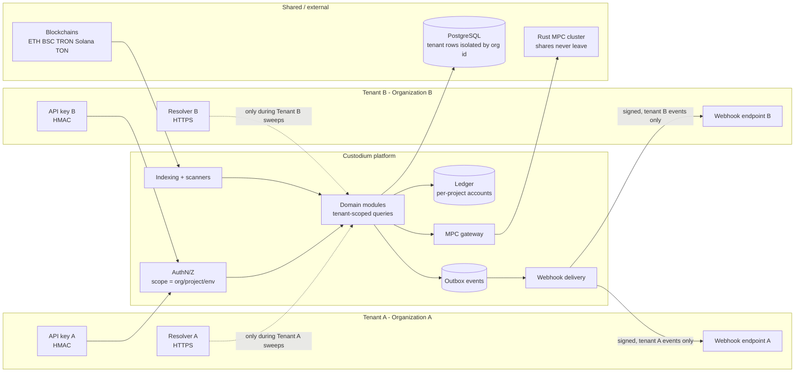
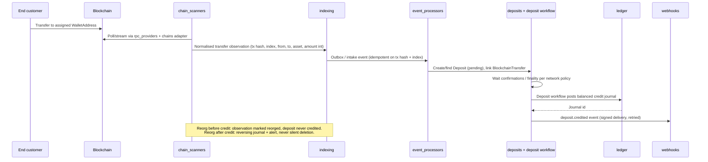
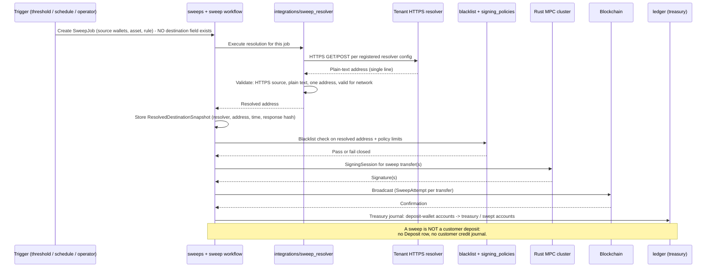

# Data Flow — Custodium

| Field | Value |
|---|---|
| Phase | Phase 0 design |
| Status | Planned — flows are the intended design |

## 1. Principles
- Money data flows in one direction per flow below; shortcuts (e.g. scanner
  writing balances) are forbidden.
- Every external input (RPC response, resolver response, webhook from chain
  providers if any, tenant API call) is validated at the boundary.
- Every state-changing flow writes: domain row + journal (if money) +
  audit (if sensitive) + outbox event, atomically where PostgreSQL allows.
- Amounts are integer base units end-to-end.

## 2. Multi-tenant data-flow diagram (Mermaid)



Isolation notes:
- Webhook delivery selects endpoints by the event's organisation — an event
  for Tenant A can never be delivered to Tenant B's endpoint.
- Resolver calls use the resolver registered on the sweeping project only.
- Ledger accounts belong to a project; journals cannot mix projects/assets.

## 3. Deposit flow



Data transformed:
- Raw chain data → normalised transfer (adapter) → deposit (domain) → journal
  lines (ledger). Each step preserves tx hash, transfer index and amount int.
- The sender address is recorded as a TransactionAddressRelation (role=source);
  the receiving WalletAddress as role=destination.

## 4. Withdrawal flow

```mermaid
sequenceDiagram
    participant Tenant as Tenant system
    participant API as Django API
    participant Pol as signing_policies + blacklist
    participant Led as ledger
    participant WF as withdrawal workflow (Temporal)
    participant MPC as Rust MPC cluster
    participant Chain as Blockchain
    participant WH as webhooks

    Tenant->>API: Create withdrawal (idempotency key, wallet, asset, amount int, destination)
    API->>Pol: Evaluate policy; check destination vs manual BlacklistEntry
    Pol-->>API: Pass / approval-required / deny
    API->>Tenant: (if required) approvals collected as WithdrawalApproval
    API->>Led: Create BalanceReservation (available decreases, total unchanged)
    API->>WF: Start workflow with withdrawal id
    WF->>Pol: Re-check policy + blacklist at execution time
    WF->>MPC: SigningSession via mpc_gateway (payload hash + policy ref)
    MPC-->>WF: Assembled signature (key never reconstructed)
    WF->>Chain: Broadcast signed tx via adapter (TransactionAttempt)
    Chain-->>WF: Confirmation / finality
    WF->>Led: Settle journal (reserved funds leave custody accounts)
    WF->>WH: withdrawal.completed / failed event
    Note over WF,Led: Failure before broadcast: reservation released by journal-backed flow.<br/>Failure after broadcast: attempt tracked; no blind re-broadcast / double pay.
```

## 5. Sweep flow



Forbidden variants (must be rejected in review and in code):
- Destination in SweepJob request body, console field, CSV/file, env var.
- Reusing a previous snapshot as a standing destination without a fresh
  resolver call for the new job, unless the resolver contract explicitly
  defines caching — default is: resolve per execution.
- Sweeping to a platform-chosen address.

## 6. Indexing / reconciliation flow
- Scanners write observations + advance checkpoints → processors normalise →
  deposits/transactions update → reconciliation compares ledger-derived
  balances vs adapter-queried on-chain balances per wallet/asset →
  breaks create run findings for human resolution.
- Reconciliation never auto-posts correction journals; a human-approved
  correction is a new, referenced journal.

## 7. Webhook / outbox flow
- Domain transaction writes OutboxEvent → event_processors claim events →
  webhooks module creates WebhookDelivery per subscribed endpoint →
  webhook_delivery worker sends signed HTTPS POST → 2xx marks delivered,
  otherwise exponential backoff → dead-letter + alert after max attempts.
- Tenants deduplicate by delivery/event id; replays create new deliveries
  linked to the same event, never duplicate journals.

## 8. Audit and metering flow
- Sensitive service calls write SecurityAuditEvent in the same transaction.
- API middleware writes APIUsageRecord asynchronously (buffered; failure to
  meter must not corrupt money data, but sustained metering failure alerts).
- Audit/metering stores are append-only and tenant-scoped on read.

## 9. Error propagation
| Failure | Behaviour |
|---|---|
| RPC provider down | Fail over endpoint; scanner lag alert; no crediting on stale data |
| Resolver down / invalid | Sweep fails closed; job marked failed; alert; no fallback destination |
| MPC quorum unavailable | Signing session expires; workflow waits/retries; no single-key fallback |
| Blacklist hit | Operation rejected before signing; audit event written |
| Insufficient balance | Reservation fails; withdrawal rejected; no partial journal |
| Webhook endpoint down | Delivery retries → dead-letter; domain operation unaffected |
| Duplicate chain event | Idempotency key (tx hash + transfer index) absorbs it |
