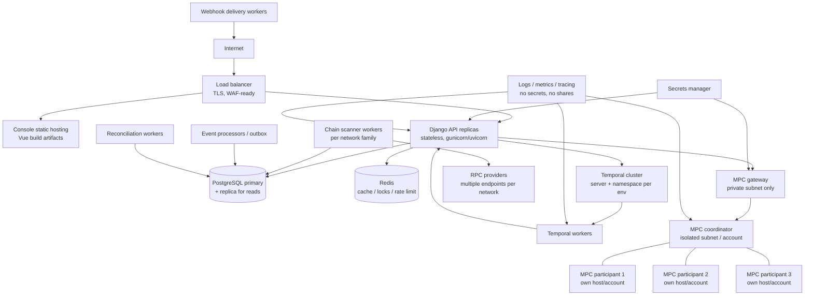

# Deployment Topology — Custodium

| Field | Value |
|---|---|
| Phase | Phase 0 design; Phase 1 runs development topology only |
| Status | Planned — no production deployment is claimed or approved |

## 1. Purpose
Describe how components from `component-diagram.md` are placed on
infrastructure so that trust boundaries (`trust-boundaries.md`) are physical /
network boundaries, not just code conventions.

## 2. Environments
| Environment | Purpose | Funds | Data |
|---|---|---|---|
| local dev | Developer machines / compose | None (testnets or mocks) | Synthetic |
| test / CI | Automated tests, integration suites | Testnet only | Synthetic |
| staging | Pre-release validation, testnet end-to-end | Testnet only | Synthetic / anonymised |
| production | Live tenants | Mainnet — ONLY after Production Approved status per PRD §3 | Real |

Rules:
- No environment shares secrets, databases or MPC participants with another.
- Testnet and mainnet projects are separated by Environment in-app AND by
  separate credentials/endpoints in deployment.
- Phase 0/1 work happens in local dev / test only.

## 3. Topology (logical)

## 4. Placement rules
- PL-1: API and workers are stateless; all durable state is in PostgreSQL /
  Temporal. Any replica can be replaced without data loss.
- PL-2: MPC participants run in separate hosts, subnets and preferably
  separate cloud accounts / failure domains from each other and from the API.
- PL-3: The MPC coordinator is reachable only from the MPC gateway service
  identity; no public ingress, no console/API direct route.
- PL-4: PostgreSQL and Redis have no public ingress; access only from API /
  worker security groups.
- PL-5: Chain scanners scale per network family (EVM, TRON, Solana, TON)
  independently, because block cadence and RPC limits differ.
- PL-6: Webhook delivery workers are the only component besides the sweep
  resolver client that makes tenant-directed outbound HTTPS calls, each with
  its own egress controls.

## 5. Scaling model
| Component | Scale trigger | Notes |
|---|---|---|
| API | Request rate / latency | Horizontal; HMAC verify is CPU-cheap |
| Scanners | Chain head lag | Partition by network + address range if needed |
| Event processors | Outbox backlog | Idempotent consumers; scale horizontally |
| Temporal workers | Workflow/activity queue depth | Separate queues per workflow family |
| Webhook delivery | Delivery backlog | Per-endpoint rate limits respected |
| PostgreSQL | CPU / IO / connections | Read replicas for reporting; ledger writes stay on primary |
| MPC cluster | Signing queue | Scale is a security decision, not autoscaling; quorum layout is fixed per wallet group |

## 6. Networking
- Private subnets: data tier (PG/Redis), signing tier (MPC), app tier.
- Egress allow-listing: RPC providers, tenant resolver hosts (per registered
  URL at call time), tenant webhook hosts, notification providers.
- DNS / TLS: all external calls HTTPS; certificate validation is never disabled.
- Sweep resolver calls originate from the sweep execution service identity
  only — see `trust-boundaries.md` B-07.

## 7. Secrets and configuration
- Secrets manager per environment: DB credentials, HMAC pepper (if used),
  RPC credentials, MPC gateway credentials, webhook signing infrastructure.
- Configuration (non-secret) via environment / config service; sweep
  destinations are NOT configuration — they are never in env vars or files.
- Key shares are not in the secrets manager used by Django; participants
  manage share storage inside the signing tier under MPC key management.

## 8. Availability and recovery
- PostgreSQL: automated backups + point-in-time recovery; restore is rehearsed
  on staging before any production consideration.
- Ledger recovery principle: balances are re-derivable from journals; a
  restored DB is validated by reconciliation before traffic resumes.
- Indexing recovery: scanners resume from `IndexingCheckpoint`; gaps trigger
  backfill scans, not manual DB edits.
- Temporal recovery: workflows resume after worker/cluster outage; in-flight
  signing sessions expire and are re-created by workflow logic, never by hand.
- MPC recovery: share backup / participant replacement follows the recovery
  workflow design (threshold-preserving); a lost share below quorum loss does
  not lose the wallet; loss beyond threshold is a documented catastrophic case,
  not something support can bypass.

## 9. Observability deployment
- Centralised structured logs with tenant/operation correlation ids.
- Metrics: API latency/errors, scanner lag per network, outbox age, webhook
  delivery success, workflow failures, signing session duration, recon breaks.
- Alerting: scanner lag, reconciliation breaks, resolver failures, MPC
  participant unavailability, webhook dead-letter growth.
- Logs/metrics/traces must never contain HMAC secrets, RPC credentials,
  resolved-share data or key material (there is none in the app tier anyway).

## 10. Release and change management
- Infrastructure as code for all tiers; manual console changes are drift.
- Database migrations reviewed for ledger/audit append-only guarantees.
- MPC crate releases require separate review + version pinning; API deploys
  cannot silently change the MPC participant set for existing wallet groups.
- Status promotion (PRD §3) is a documented decision, not a deploy side effect.

## 11. Development topology (Phase 1 actual)
- Single-machine compose: Django, PostgreSQL, Redis, Temporal dev server,
  Vue dev server; MPC and chain integrations stubbed/mocked ONLY for SaaS
  foundation work, and labelled as mocks — mocks are never described as MPC.
- Phase 1 exit does not require staging or production topology to exist.

## 12. Non-goals
- No multi-region active-active claim in Phase 0.
- No Kubernetes requirement: topology is orchestrator-agnostic; the placement
  and isolation rules are the requirement, not the platform brand.
- No production topology sign-off in this document.
