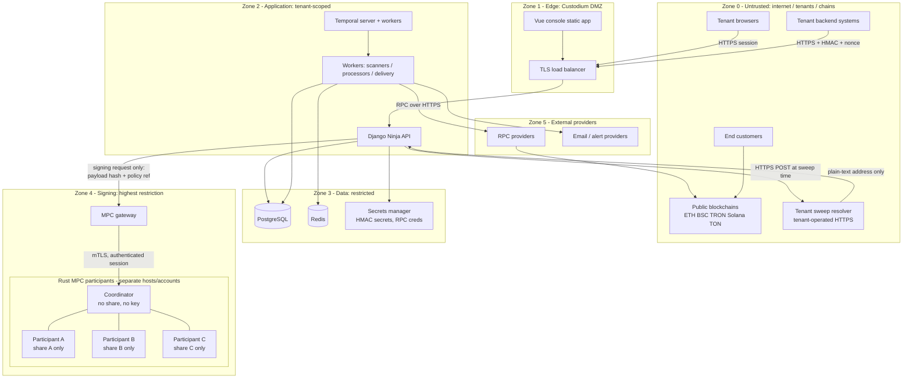

# Trust Boundaries — Custodium

| Field | Value |
|---|---|
| Phase | Phase 0 design |
| Status | Planned — controls are requirements, not evidence of a completed audit |

## 1. Purpose
Define where trust changes, what crosses each boundary, what must be verified
at crossing, and what must never cross. Compromise of an outer zone must not
imply compromise of an inner zone — especially key shares.

## 2. Trust-boundary diagram (Mermaid)

## 3. Zones
| Zone | Trust level | Contents | Compromise containment |
|---|---|---|---|
| 0 Untrusted | None | Browsers, tenant systems, chains, resolver | Assume hostile/malformed input |
| 1 Edge | Low | TLS termination, static console | No secrets, no data at rest |
| 2 Application | Medium | Django API, workers, Temporal | Tenant-scoped; no key shares |
| 3 Data | High | PostgreSQL, Redis, secrets manager | Encrypted, access-logged, backed up |
| 4 Signing | Highest | MPC gateway + Rust participants | Separate network/accounts; quorum needed |
| 5 Providers | Low–Medium | RPC, notifications | Verify responses; never trust a single RPC blindly |

## 4. Boundary crossing rules

### B-01 Browser → API
- HTTPS only; secure, HttpOnly session cookies; CSRF protection; MFA-ready.
- Console never receives API HMAC secrets after creation display, never shares.

### B-02 Tenant system → API
- API key id + HMAC over method/path/body-hash/timestamp/nonce.
- Replay window + nonce store in Redis; expired/duplicate requests rejected.
- Authorisation is per-permission and per project/environment scope.

### B-03 API/workers → PostgreSQL
- Least-privilege DB roles per service class; migrations use a separate role.
- Tenant filters enforced in service layer + query scoping, tested per module.
- Ledger and audit tables: application role has INSERT/SELECT, no UPDATE/DELETE
  on journal/audit rows (enforced by grants + triggers where feasible).

### B-04 Application → Secrets manager
- Secrets fetched at runtime, scoped per service, never written to logs,
  never returned by any API, never stored in the repository.

### B-05 Application → MPC gateway → MPC cluster  (critical boundary)
- Only signing *requests* cross: operation id, payload/transaction hash,
  wallet group id, policy version reference, chain/network, approval evidence.
- Key shares, share fragments and complete keys NEVER cross this boundary,
  in either direction, ever.
- mTLS + service identity between gateway and coordinator.
- MPC side independently verifies signing policy and quorum approvals;
  a compromised Django instance alone cannot obtain a signature that
  violates policy — and cannot sign at all without participant quorum.
- Coordinator holds no share; participants hold exactly one share each,
  on separate hosts / failure domains.

### B-06 Workers → RPC providers → chains
- RPC responses are untrusted data: validate chain id, amounts, addresses,
  confirmations; detect provider disagreement / reorg signals.
- Private keys are never sent to RPC providers; only signed transactions.
- Multiple endpoints per network are supported (`NetworkEndpoint`) so a
  single provider is not a silent single point of truth for crediting.

### B-07 Sweep execution → Tenant resolver  (critical boundary)
- Outbound HTTPS only, to the exact tenant-registered resolver URL for that
  project; redirects to other hosts are not followed.
- Response must be plain text containing exactly one address valid for the
  sweep's network. HTML/JSON/multi-address/invalid responses fail closed.
- The resolved address is snapshotted (`ResolvedDestinationSnapshot`),
  blacklist-checked, and only then used. It is never cached for reuse as a
  standing destination beyond the resolver's own semantics, and never read
  from the sweep request, local files or environment variables.
- Resolver compromise is a tenant-side risk: mitigations are snapshot audit,
  blacklist check, policy limits on sweep size/frequency, and alerting on
  destination change — Custodium cannot verify tenant intent beyond these.

### B-08 Application → Tenant webhooks
- HTTPS only; payloads signed with the endpoint secret; delivery ids enable
  tenant-side deduplication; no secrets or share data in payloads.

### B-09 Temporal boundary
- Workflow code is deterministic and contains no secrets; activities re-check
  policy/blacklist/reservation state at execution time, not only at start.
- Temporal history may contain operation metadata — never key material.

## 5. Insider and admin boundaries
- Platform Admin can operate networks/assets and suspend tenants, but has no
  API path to: export shares, sign arbitrarily, edit journals, or set sweep
  destinations.
- Tenant Admin cannot read another tenant's data, alter audit events, or
  lower a signing policy retroactively for in-flight withdrawals.
- Break-glass procedures, if ever defined, require dual control + audit and
  are out of scope for Phase 0/1 — their absence must not be worked around.

## 6. Data classification at boundaries
| Class | Examples | Crossing rule |
|---|---|---|
| Public | Network names, asset symbols | Free |
| Tenant-confidential | Balances, addresses, operations | Tenant zone only, audited |
| Secret | HMAC secrets, RPC credentials | Secrets manager only, never logged |
| Critical secret | Key shares | Never leave participant; never cross B-05 |
| Integrity-critical | Journals, audit events, snapshots | Append-only, hash-conscious handling |

## 7. Explicit non-controls (honesty)
- Custodium does NOT perform AML/KYT screening; blacklist is manual only.
  Do not describe blacklist checks as compliance screening.
- Custodium does NOT claim MPC security beyond the implemented/reviewed
  protocol status (PRD taxonomy). Design intent is not audit evidence.
- No production approval is asserted by this document.
