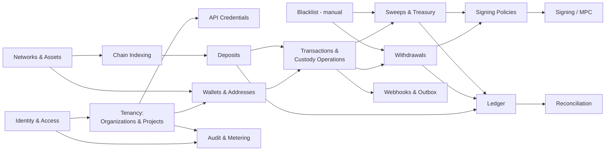

# Bounded Contexts — Custodium Domain

| Field | Value |
|---|---|
| Phase | Phase 0 design |
| Status | Planned |

## 1. Purpose
Partition the domain so each context owns a consistent model and language.
The module map (`docs/architecture/module-responsibility-map.md`) is the code
view; this document is the domain view. They align 1:1 by design in Phase 0.

## 2. Context map

## 3. Contexts in detail

### 3.1 Identity & Access
- Language: User, session, credential, MFA.
- Owns authentication truth. Emits: user authenticated, session revoked.
- Upstream of everything; knows nothing about wallets or money.

### 3.2 Tenancy (Organizations & Projects)
- Language: Organization (tenant), Membership, Role, Permission, Project,
  Environment.
- Owns who belongs to which tenant and in what scope. Every other context
  references organisation/project ids but does not redefine membership.

### 3.3 API Credentials
- Language: APIKey, scope, HMAC, nonce, rotation.
- Owns machine authentication for a project/environment. Consumes Tenancy
  scope; consumed by the API edge for every tenant-system request.

### 3.4 Networks & Assets
- Language: BlockchainNetwork, NetworkEndpoint, Asset, TokenMetadata,
  confirmations, finality, decimals, base unit.
- Owns chain/asset reference data. Published language (network code, asset
  code) is used by all downstream contexts instead of raw chain parameters.

### 3.5 Wallets & Addresses
- Language: MPCWalletGroup, MPCParticipant, KeyShareReference, Wallet,
  WalletAddress, AddressAssignment, ExternalCustomerReference.
- Owns wallet/address identity and assignment. “KeyShareReference” is a
  locator, never key material — the language itself prevents confusion.
- Consumes Signing/MPC for wallet-group creation results.

### 3.6 Chain Indexing
- Language: IndexingCheckpoint, observation, transfer, reorg, finality lag.
- Owns the translation of chain reality into normalised transfers.
- Anti-corruption layer: raw RPC shapes never leak past this context.

### 3.7 Transactions & Custody Operations
- Language: BlockchainTransaction, BlockchainTransfer,
  TransactionAddressRelation, CustodyOperation, TransactionAttempt.
- Owns the shared spine that deposits, withdrawals and sweeps specialise.
- An operation is the unit tenants track; an attempt is one broadcast try.

### 3.8 Deposits
- Language: Deposit, pending, confirmed, credited, reversed.
- Owns the promise “these observed funds are now this customer's balance”.
- Consumes Indexing transfers and Ledger posting; publishes deposit events.

### 3.9 Withdrawals
- Language: Withdrawal, WithdrawalApproval, reservation, destination.
- Owns tenant-instructed outbound payments and their approval lifecycle.
- Consumes Policies, Blacklist, Ledger reservations and Signing.

### 3.10 Sweeps & Treasury
- Language: SweepDestinationResolver, SweepJob, SweepAttempt,
  ResolvedDestinationSnapshot, TreasuryOperation.
- Owns consolidation of deposit-wallet funds to tenant destinations.
- Defining rule of the context: destinations are resolved, never supplied.
  The resolver — tenant-registered, HTTPS, plain-text response — is part of
  this context's language precisely so no other phrasing (“destination
  parameter”) can creep in.
- A sweep is a treasury movement, linguistically and in the ledger distinct
  from a deposit.

### 3.11 Ledger
- Language: LedgerAccount, JournalEntry, JournalLine, debit, credit,
  BalanceReservation, derived balance.
- Owns economic truth. It deliberately has no words for chains, blocks or
  signatures — operations translate money movement into journals.
- Conformist relationship: all money contexts conform to ledger language
  for amounts (integer base units) and posting rules.

### 3.12 Signing Policies & Signing (MPC)
- Language (policy): SigningPolicy, limit, quorum of approvals, velocity.
- Language (signing): SigningSession, participant, threshold, partial
  signature, assembled signature.
- Policy is defined in Django; enforcement happens in both policy context
  and the Rust MPC boundary (separate context, separate codebase, published
  protocol: signing request = payload hash + policy reference + approvals).
- No context may introduce the phrase “full key”; the concept does not exist.

### 3.13 Blacklist
- Language: BlacklistEntry, reason, actor, manual entry.
- Small context by design. Manual entries only — no screening, scoring or
  AML/KYT language exists here, because that product is not in scope.
- Consumed by Withdrawals and Sweeps (on the resolved destination).

### 3.14 Reconciliation
- Language: ReconciliationRun, expected (ledger) balance, observed (chain)
  balance, break.
- Owns comparison, not correction. Breaks are handed to humans; corrections
  re-enter through the owning money context as new journals.

### 3.15 Events, Webhooks, Audit, Metering
- Language: WebhookEndpoint, WebhookDelivery, OutboxEvent,
  SecurityAuditEvent, APIUsageRecord.
- Shared kernel for cross-context facts: an event happened, it was delivered,
  it was audited, it was metered. These contexts record; they never decide.

### 3.16 Platform Administration
- Language: platform operator, network activation, tenant suspension.
- Owns operator-only concepts. Explicitly has no language for moving tenant
  funds — absence of vocabulary is a security property.

## 4. Relationships and contracts
| Pair | Pattern | Contract |
|---|---|---|
| Indexing → Deposits | Published language | Normalised transfer (tx hash, index, addresses, asset, amount int) |
| Money contexts → Ledger | Conformist | Journal posting request with idempotency key |
| Withdrawals/Sweeps → Signing | Published protocol via MPC gateway | Payload hash + policy ref + approval evidence |
| Sweeps → Tenant resolver | Anti-corruption layer | HTTPS call; plain-text → validated network address + snapshot |
| Adapters → Indexing | Anti-corruption layer | `chains/base` contract; no RPC types leak inward |
| All → Audit/Outbox | Shared kernel | Append-only event write inside the caller's transaction |
| API edge → All | Open host (internal) | Service interfaces only; no cross-context ORM writes |

## 5. Consistency boundaries
- Strong consistency inside: a journal posting; a reservation + availability
  check; an audit event + its action; outbox + domain write.
- Eventual consistency between: indexing observation → deposit credit;
  domain event → webhook delivery; ledger → reconciliation result.
- Temporal workflows are the consistency mechanism across Signing, Chains
  and Ledger for withdrawals and sweeps.

## 6. Context evolution rules
- Splitting a context requires updating this doc, the module map and the ERD
  together.
- New vocabulary for money destinations, key handling or screening requires
  security review — these three areas have deliberately narrow language.
- If a proposed feature needs a context to know another context's internals,
  the feature design is wrong, not the boundary.
